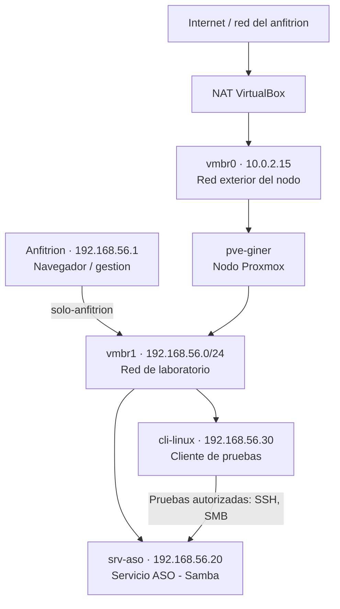

# 02-diagrama-red

## Objetivo

Disenar la red del laboratorio antes de instalar servicios. Se define el
direccionamiento del nodo Proxmox y de las dos cargas (srv-aso y cli-linux),
los bridges que las conectan, el gateway y DNS, los puertos necesarios y las
medidas de aislamiento. Modalidad: **Proxmox virtualizado** en VirtualBox

## Diseno de red

El montaje sigue la guia de VirtualBox del curso: la VM Proxmox tiene **dos
adaptadores**, y el nodo define **dos bridges**.

- **Nodo Proxmox:** `pve-giner`.
- **Interfaz de gestion:** panel web HTTPS en el puerto 8006, accesible desde el
  navegador del anfitrion por la red solo-anfitrion.
- **Bridges de Proxmox:**
  - `vmbr0`: red exterior del nodo. Asociado al adaptador 1 (NAT de VirtualBox).
    Da salida a Internet para actualizaciones.
  - `vmbr1`: red interna de laboratorio `192.168.56.0/24`. Asociado al
    adaptador 2 (solo-anfitrion). Conecta gestion y cargas; el nodo actua de
    gateway de los invitados.
- **Red de laboratorio:** `192.168.56.0/24`. Sin VLAN (no necesarias; no se
  modifica la red del aula).
- **Gateway de los invitados:** `192.168.56.10` (el propio nodo, que enruta/NAT
  hacia `vmbr0` y la salida de VirtualBox).
- **DNS:** el que indique el profesor (o el gateway del anfitrion a traves del
  NAT).

## Tabla de direccionamiento

| Elemento     | Nombre      | IP               | Funcion            | Recursos    |
| ------------ | ----------- | ---------------- | ------------------ | ----------- |
| Nodo Proxmox | `pve-giner` | `192.168.56.10` (vmbr1) / `10.0.2.15` (vmbr0, NAT) | Hipervisor | PENDIENTE (segun equipo personal) |
| Servidor ASO | `srv-aso`   | `192.168.56.20`  | Servicio principal | PENDIENTE   |
| Cliente      | `cli-linux` | `192.168.56.30`  | Pruebas            | PENDIENTE   |

El anfitrion tiene `192.168.56.1` en la red solo-anfitrion (administracion
local). Mascara `/24`: los tres invitados estan en la misma subred, por lo que
`cli-linux` alcanza a `srv-aso` directamente por `vmbr1`, sin pasar por el
gateway. El gateway (`.10`) solo interviene para destinos externos.

## Puertos necesarios

| Puerto    | Protocolo | Servicio            | Origen -> Destino          |
| --------- | --------- | ------------------- | -------------------------- |
| 8006      | TCP       | Panel web Proxmox   | Anfitrion -> `pve-giner`   |
| 22        | TCP       | SSH                 | Admin/`cli-linux` -> VM    |
| 445 / 139 | TCP       | Samba (SMB/CIFS)    | `cli-linux` -> `srv-aso`   |
| 137 / 138 | UDP       | NetBIOS (si aplica) | `cli-linux` -> `srv-aso`   |

Servicio ASO previsto: Samba con ACL (puertos 445 y 139). Si no se usa
resolucion NetBIOS, 137/138 pueden omitirse.

## Diagrama de red

## Justificacion de aislamiento y permisos

- **Dos redes separadas a proposito:** el trafico de trabajo (gestion y
  cliente <-> servidor) va por `vmbr1` (`192.168.56.0/24`); la salida a Internet
  va por `vmbr0` (NAT). El panel de Proxmox se alcanza por la red
  solo-anfitrion, no por la salida exterior.
- **La red solo-anfitrion separa el laboratorio** del resto, pero el anfitrion
  sigue formando parte de ella: no es una barrera total, segun recuerda la
  teoria del curso.
- **Sin VLAN:** no se exigen y no se toca la red del centro. El aislamiento se
  apoya en el direccionamiento, el firewall de Proxmox (si se activa) y las ACL
  del servicio.
- **Permisos de servicio:** el acceso al recurso Samba se controla por
  pertenencia al grupo `grupo_asir` y ACL en `srv-aso`. La prueba de acceso
  denegado usa un usuario Samba valido pero fuera del grupo.
- **Superficie minima:** solo se abren los puertos listados. Panel (8006) y SSH
  (22) para administracion; Samba (445) solo entre `cli-linux` y `srv-aso`.
- **Modo promiscuo:** el adaptador solo-anfitrion puede necesitar modo promiscuo
  en VirtualBox para transportar las MAC de los invitados internos; se aplica
  solo a ese adaptador de laboratorio, no de forma indiscriminada.

## Evidencias

Enlazar desde `../evidencias/`:

- Diagrama de red (este documento / exportacion del Mermaid).
- Tabla de direccionamiento.
- Version de VirtualBox y configuracion de los dos adaptadores de la VM.
- Salida de `ip -br addr` y `ip route` del nodo una vez instalado, que confirme
  las IPs y el gateway en ambos bridges.
- Captura del panel Proxmox mostrando `vmbr0` y `vmbr1`.

## Conclusion

El diseno virtualizado usa dos redes: `vmbr0` (NAT, salida a Internet) y `vmbr1`
(laboratorio `192.168.56.0/24`), con el nodo `pve-giner` (.10) actuando de
gateway de los invitados `srv-aso` (.20) y `cli-linux` (.30). La comunicacion
cliente-servidor es directa por `vmbr1` para las pruebas del servicio ASO, y la
salida exterior pasa por el nodo y el NAT de VirtualBox. El aislamiento se apoya
en la separacion de redes, la apertura minima de puertos y las ACL del servicio,
sin VLAN ni cambios en la red del centro. Quedan pendientes los recursos
asignados a cada maquina (segun el equipo personal) y el DNS definitivo.

[Volver al indice](../README.md)
